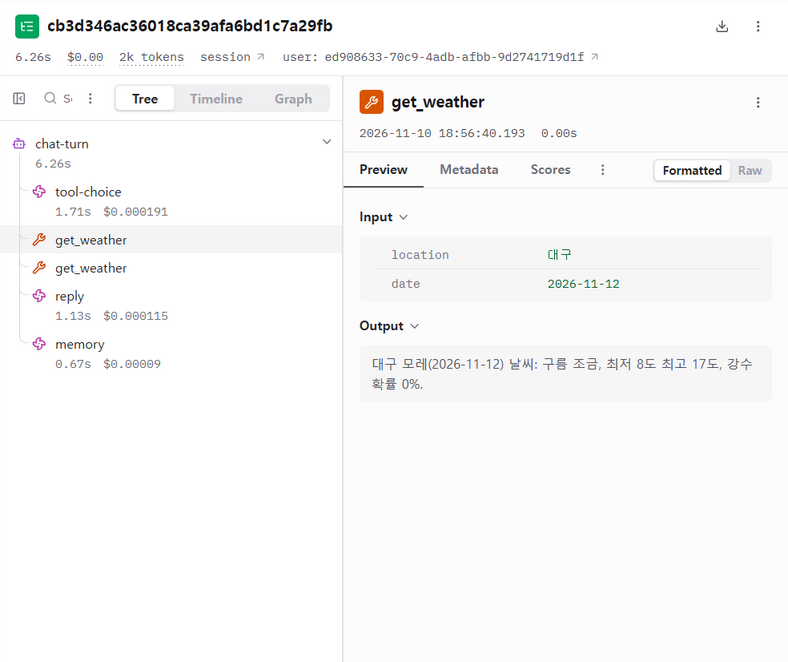
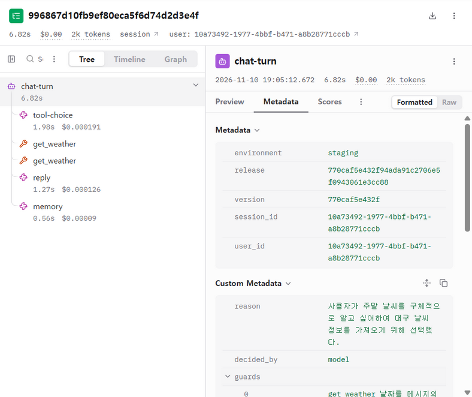

# 개선 리포트 — 로그와 피드백으로 에이전트 개선하기

> 아이펠 「AI 서비스 인 프로덕션」 15. 프로젝트 제출물. 대화 내용이 담긴 파일과 키는 이 저장소에 올리지 않는다.

**요약** — staging 트레이스 85개와 별로예요 17개에서 문제 후보 3개를 찾았고, 별로예요로 가장 자주 이어진 **날짜 해석 오류**(“이번 주말”을 금·토로, “토요일”을 목요일로 조회)를 골랐다. 지시문(달력)을 고치는 시도 3번은 정상 항목이 떨어져 버렸고, **요일·주말은 코드가 날짜를 계산해 도구 인자를 고치는 안전장치**로 문제 항목 36%→86%, 정상 항목 100% 유지를 얻었다. 배포 뒤 새 문장으로 버전별 비교: 날짜 해석 오류 3건→0건(안전장치 3번 작동), 다만 요일·주말 턴의 별로예요는 3/11 그대로 — 남은 원인은 답 생성 단계(B). 덤으로, 관측 도구 자체가 트레이스를 절반 가까이 잃던 문제를 찾아 고쳤다.

## 0. 관측 준비 (이번에 붙인 것)

이 저장소에는 트레이스와 피드백이 없어서 먼저 붙였다.

- `app/tracing.py`: 대화 한 턴 = Langfuse 트레이스 `chat-turn` 하나. 아래에 `tool-choice`(도구 선택), 도구 실행(`get_weather` 등), `reply`(답), `memory`·`summary`(기억 정리) 모델 호출이 붙고 토큰·비용·지연이 남는다.
- **version = 배포한 커밋**(`COMMIT_SHA`), environment = `staging`. 고치기 전후를 이 값으로 나눈다.
- 화면의 신고 버튼(별로예요) → 그 답의 트레이스에 점수 `user-feedback=0`(이유는 comment).
- 키는 Secret Manager `langfuse-secret-key` 를 이름으로 연결. 키가 없으면 트레이스는 꺼진다.

### 관측 도구에서 먼저 찾은 문제: 트레이스가 한 턴 걸러 하나씩 사라짐

| 항목 | 내용 |
| --- | --- |
| 현상 | 첫 수집 40턴 중 17개, 두 번째 40턴 중 15개만 Langfuse 에 도착. 빠진 위치가 `.O.O.O.O…` 로 한 턴 걸러 하나 |
| 처음 짚은 원인(틀림) | 응답 뒤 CPU 가 줄어 백그라운드 전송이 끊긴다고 보고 자동 전송을 껐다 → 다음 수집에서도 같은 패턴. 되돌림 |
| 근거 | `LANGFUSE_DEBUG` 로그: 빠진 턴은 span 이 **하나도 기록되지 않음**. FastAPI 가 Cloud Run 이 붙인 `traceparent` 를 이어받는데, Cloud Run 은 일부 요청만 ‘기록함(01)’으로 표시해 ‘기록 안 함(00)’ 요청의 하위 span 이 모두 버려짐. 로컬에서 `traceparent: …-00` 헤더로 재현 |
| 고침 | 트레이스를 빈 맥락에서 새로 시작(`app/tracing.py` `Turn`). 커밋 `95a3422` |
| 확인 | 고친 버전 수집 40턴 → 40개 도착 |

## 1. 로그

- 분석한 트레이스 수: **85개** (staging, version `e863928` 45개 + `95a3422` 40개). 보낸 턴은 136개였고 51개는 위 유실 문제로 남지 않았다.
- 피드백 수(별로예요): **17개**
- 직접 만든 대화: `scripts/simulate_users.py`. 사용자 유형 8개(출근하는 직장인, 부산 사는 대학생, 기억을 확인하는 사용자, 말을 바로잡는 사용자, 약속을 관리하는 사용자, 짧게 말하는 사용자, 고민 상담, 여행 계획) × 5턴을 staging 에 보냈다. 사용자마다 Supabase 익명 로그인을 새로 해 user_id 가 다르다. 답마다 사용자 시뮬레이터(gpt-4o-mini)가 “이 사용자라면 별로예요를 누를까”를 판단해, 누르면 `/api/report` 로 보낸다(“실제 사용자는 웬만하면 누르지 않는다”고 지시). 실제 개인정보는 쓰지 않았고, 대화 원문이 담긴 결과 파일은 `.local/`(gitignore)에만 있다.
- 트레이스 내려받기와 집계: `scripts/export_traces.py`, 후보 세기: `scripts/count_candidates.py`(규칙은 파일 맨 위).

## 2. 문제 후보 (3개 이상)

| # | 현상 | 근거 트레이스(앞 8자리) | 반복 횟수 | 처음 어긋난 단계 |
|---|---|---|---|---|
| A | **날짜 해석 오류.** “이번 주말 인천 날씨”를 11/12~13·11/13~14 로 조회한 뒤 “주말 날씨는 모른다”고 답함. “여행 가기 전날 밤 10시”를 11/9(지난 시각)로 잡아 약속 저장 실패 → “할 수 있는 기능이 아니야” | ad3a6891, ea475335, f6fdd2be, 6c315b22, 70358a00, 5e105d0c | **6건 / 요일·주말·전날 표현이 있는 13턴** (그중 별로예요 5) | `tool-choice` 의 date·due_at 인자 |
| B | **결과가 있는데 모른다고 함.** 대구·대전 날씨 조회가 성공했는데 “정확히 알려 줄 수 없어”, 약속 저장이 성공했는데 “미안, 그건 못해!” | 24853a78, 57707777, a901cc19 (+A 때문인 ad3a6891, ea475335) | 5건 / 85 (그중 별로예요 4) | `reply` (도구 결과를 무시) |
| C | **묻지 않은 도구.** “운동 시작하려고”에 미세먼지 이틀 치 조회, “날씨” 한 마디에 오늘·내일 둘 다 조회, “내 약속 뭐 있어?”에 약속을 새로 저장 | e07d4051, a60ccc2e, 3e84177f, dc17e75e, 3e87b25f, d602fd24, 10e49e9a, d61bfb8a | 8건 / 85 (그중 별로예요 3) | `tool-choice` |

별로예요 17개 중 나머지 7개는 말투(공감 없이 조언만, 되묻기를 덧붙임)나 시뮬레이터의 과한 판단(12월 공휴일이 크리스마스뿐인 게 맞는데 누름)이라 후보로 묶지 않았다.

## 3. 고른 문제와 이유

| 후보 | 빈도 | 영향 | 고치는 비용 |
|---|---|---|---|
| A 날짜 해석 오류 | 요일·주말 표현이 있는 턴의 46%(6/13). 데이터셋에서 고치기 전 문제 항목 통과율 33~36% | **큼.** 6건 중 5건이 별로예요. 틀린 날짜로 조회하면 답이 “모른다”가 되거나(B 의 원인), 약속이 안 저장되거나 엉뚱한 날 저장됨 | 작음. 날짜 계산은 코드로 확실히 할 수 있다 |
| B 결과 있는데 모른다 | 5/85 (A 때문인 2건 포함) | 큼. 질문에 답을 못 함 | 중간. 답 생성 지시문 문제라 원인이 여러 갈래(지어내지 말라는 규칙과 충돌 추정) |
| C 묻지 않은 도구 | 8/85 | 작음~중간. 대부분 비용·지연만 늘고 답은 맞음. 다만 부탁 없이 약속을 저장한 1건은 데이터를 바꿈 | 중간. 지시문을 고치면 다른 선택에도 영향 |

고른 이유: A 는 별로예요로 이어지는 비율이 가장 높고(5/6), B 의 일부를 함께 없애며, “토요일 = 11/14” 처럼 정답이 하나라 코드로 고칠 수 있어 비용이 가장 작다.

## 4. 데이터셋과 기준

- 데이터셋: `data/eval/date_resolution.jsonl`, 평가: `scripts/eval_dates.py` (도구 선택 단계만 따로 돌림, 항목마다 3번 반복)
- 항목 수: 문제 **12** / 정상 **12**
  - 문제: 트레이스에서 틀린 표현(이번 주말, 주말, 토요일 말고 일요일, 여행 전날 밤, 주말 미세먼지)과 같은 종류의 표현(다음 주말, 토요일 아침 8시, 일요일 밤, 금·토요일에 묻는 주말)
  - 정상: 원래 잘 되던 것(오늘·내일·모레 날씨, 금요일 저녁 7시 알림, 다음 주 월요일 알림, 미세먼지, 다음 달 공휴일, 도구가 필요 없는 일상 대화 3개)
- 통과 조건의 예:
  - “이번 주말에 인천 가려고 하는데 날씨 어때?”(오늘 11/10 화) → `get_weather` 의 date 집합이 정확히 {2026-11-14, 2026-11-15}
  - “토요일 아침 8시에 등산 가라고 알려 줘” → `create_reminder` due_at = 2026-11-14T08:00
  - “요즘 잠을 잘 못 자” → 도구 없음 (묻지 않은 도구를 부르면 실패)
- 실험 전에 정한 내보낼 기준: **문제 항목 통과율 80% 이상**, **정상 항목 통과율이 고치기 전보다 낮지 않고 90% 이상** (각 36회 = 12항목 × 3번)

## 5. 바꾼 것과 전후 비교

- 바꾼 것(한 가지): 도구 선택 뒤 안전장치 `router.fix_mentioned_dates` — 메시지에 요일 이름(“토요일”, “다음 주 월요일”)이나 “주말·다음 주말”이 있으면 코드(`when.mentioned_dates`)로 날짜를 계산해, 모델이 고른 날씨·미세먼지 날짜와 약속 날짜를 맞춘다(약속 시각은 모델 값 유지). 고친 내용은 턴 패널의 안전장치 목록에 남는다. “전날”처럼 다른 날을 기준으로 다시 세는 말, 요일이 둘 이상인 말은 건드리지 않는다.
- 실험 결과(실패한 시도 포함):

| 시도 | 바꾼 것 | 문제 항목 | 정상 항목 | 판단 |
|---|---|---|---|---|
| 고치기 전 (2번 측정) | — | 12/36 (33%), 13/36 (36%) | 34/36 (94%), 36/36 (100%) | |
| 1 | 달력 지시문을 날짜마다 한 줄로 펼치고 주말·오늘·내일·다음 주 표시 | 35/36 (97%) | 31/36 (86%) | 버림 — 정상 항목 하락. “다음 주 월요일 알림”에 묻지 않은 `list_reminders` 를 3번 모두 덧붙임 |
| 2 | 1에서 ‘다음 주’ 표시만 뺌 | 35/36 (97%) | 29/36 (81%) | 버림 — 다음 주 월요일을 11/23 로 잡음, 미세먼지 이틀 치 조회 |
| 3 | 원래처럼 두 줄로 줄이고 ‘요일 이름 날짜’ 순서 + 주말 줄 | 32/36 (89%) | 28/36 (78%) | 버림 — 묻지 않은 도구가 여전히 늘어남 |
| **4** | **지시문은 그대로, 코드 안전장치로 날짜만 고침** | **31/36 (86%)** | **36/36 (100%)** | **내보냄** — 기준 둘 다 통과 |

  - 배운 점: 지시문에 날짜 정보를 늘리면 날짜는 맞아도 “꼭 필요한 도구만” 규칙이 묽어져 다른 곳이 나빠졌다. 정상 항목이 없었다면 시도 1(97%)을 내보냈을 것이다.
  - 남은 실패 5건은 모두 “여행 가기 전날”, “주말 전날”처럼 다른 날 기준으로 다시 세는 표현이다(안전장치가 일부러 건드리지 않음).
- PR: {{PR_LINK}}

## 6. 배포 뒤 확인

데이터셋에 없는 **새 문장 묶음**(`scripts/simulate_users.py --set check`, 사용자 8명 33턴: 다른 도시·표현으로 바꾼 날씨, 기억, 정정, 짧은 말, 약속, 상담 + 요일·주말 새 문장 10개)을 **고치기 전 버전과 고친 버전에 똑같이** 보내고, Langfuse 트레이스를 version 으로 나눴다(`scripts/export_traces.py --since …`, `scripts/count_candidates.py --version …`).

- 새 대화에서 버전별 같은 현상 횟수:

| | 고치기 전 `95a3422` | 고친 뒤 `770caf5` |
|---|---|---|
| 트레이스 | 33 | 33 |
| **A 날짜 해석 오류** (실제로 실행된 도구 인자 기준) | **3** (cb3d346a 주말→11/12·13, 59118672 다음 주말→11/12, 61fa1103) | **0** (안전장치 작동 3번) |
| B 결과 있는데 모른다 | 5 | 1 |
| C 묻지 않은 도구 | 4 | 3 |
| 별로예요 전체 | 7 | 5 |
| 요일·주말 턴(11개)의 별로예요 | 3 | 3 |

- 판단: **고친 단계(도구 선택의 날짜)는 나아졌다** — 실행된 날짜가 모두 맞았다. 하지만 **사용자 반응(요일·주말 턴의 별로예요)은 줄지 않았다.** 고친 버전의 별로예요 3건을 읽어 보면 원인이 다음 단계로 옮겨 갔다:
  - d7237885 “이번 주말 대구 날씨 괜찮을까?” — 11/14·15 날씨를 받고도 “대구 날씨는 잘 모르겠어. 하지만 소나기랑 이슬비가…” (B: 답 생성이 도구 결과를 부정)
  - 996867d1 “주말 내내 비 오는 거 아니지?” — 별로예요는 없었지만 답이 “13일 소나기, 14일 이슬비”로 날짜를 하루씩 틀리게 말함(도구 결과는 14일·15일)
  - a5cf3cd0 “다음 주말 부산 미세먼지” — 11/21·22 를 정확히 조회했고 “4일 뒤까지만 볼 수 있다”를 받았지만 답이 “다음 주말은 11월 20일”이라고 날짜를 지어냄
  - 그래서 다음 개선 후보는 **B(답 생성이 도구 결과를 무시하거나 날짜를 바꿔 말함)** 이다. 데이터셋은 이번 새 문장의 트레이스로 만들 수 있다.
- 지연 시간과 비용(턴 전체): 중앙값 5.7s → 5.8s, p90 6.3s → 6.8s, 턴당 $0.00037 → $0.00037. 안전장치는 코드 계산이라 모델 호출이 늘지 않는다. 지연 차이는 33턴 표본의 흔들림 범위로 본다(같은 버전 수집 간 p90 6.6~6.9s).
- 화면 캡처 (Langfuse, 계정 정보는 잘라냄):

| 고치기 전 `95a3422` — “주말 내내 비 오는 거 아니지?” → `get_weather` date 2026-11-12(목) | 고친 뒤 `770caf5` — 같은 문장, version 과 안전장치 기록(guards: 11/14·15 로 고침) |
|---|---|
|  |  |

## 7. 회고

- 가장 어려웠던 점: 숫자를 믿을 수 있게 만드는 일. 처음 수집한 트레이스가 절반 가까이 비어 있었는데 오류 로그는 하나도 없었고, 첫 추측(백그라운드 전송)은 틀렸다. 디버그 로그로 “빠진 턴은 span 이 아예 안 만들어졌다”를 확인하고 나서야 원인(이어받은 traceparent)이 보였다. 관측 도구도 관측해야 한다. 두 번째는 지시문 수정의 부작용 — 문제 항목만 봤다면 97% 짜리 시도를 내보냈을 것이다.
- 내 프로덕트에서 실제 사용자에게 모을 로그와 피드백:
  - 로그(트레이스): 턴마다 도구 선택 결과와 인자(특히 날짜), 도구 성공·실패, 안전장치가 고친 내용, 지연과 비용, version. 원문은 관측 도구에만 두고 Cloud Logging 에는 개수만.
  - 명시적 피드백: 답마다 별로예요(+ 선택 이유 몇 개: 틀린 정보 / 질문을 못 알아들음 / 말투).
  - 암묵적 피드백: “아니 그게 아니라”, “말고” 같은 정정 턴, 같은 질문 반복, 약속을 만든 직후 취소, 답 뒤 바로 끊긴 세션. 별로예요보다 훨씬 많이 쌓이므로 어느 트레이스부터 읽을지 정하는 데 쓴다.
  - 안전장치가 날짜를 고친 횟수 자체를 지표로 본다(모델을 바꿨을 때 늘면 회귀 신호).
