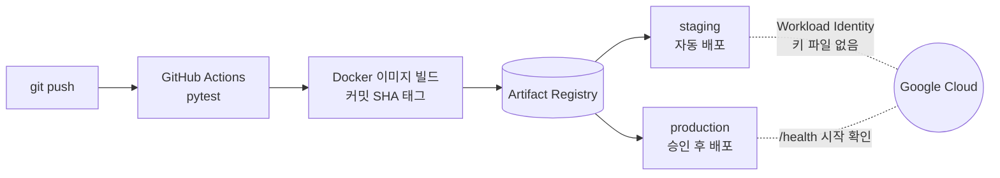
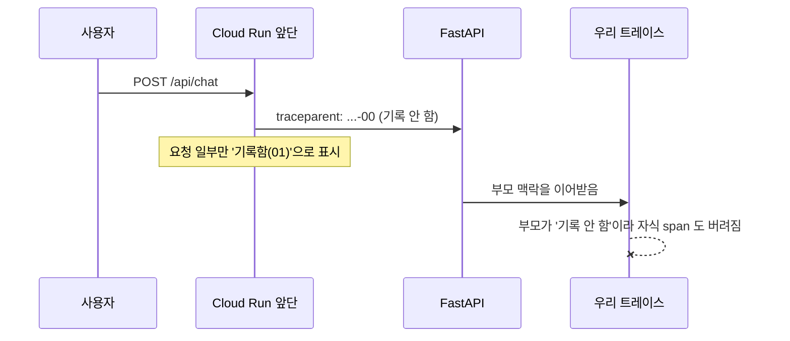

# 트레이스가 절반 비어 있었는데, 오류 로그는 한 줄도 없었다

> 아이펠 「AI 서비스 인 프로덕션」 모듈 회고. AI 친구 에이전트를 Cloud Run 에 올리고, 자동 배포·무중단 배포를 붙이고, 마지막에 트레이스와 피드백으로 한 군데를 고쳐 본 기록이다. 숫자는 모두 이번 실습에서 직접 잰 값이다.

**세 줄 요약**
- 배포는 “초록불이 켜졌다”에서 끝나지 않는다. 바꿔치기 배포 한 번에 요청 4개가 끊겼고, 준비 확인 없이 띄운 새 버전은 21초 동안 100개를 놓쳤다.
- 관측 도구도 관측해야 한다. Langfuse 트레이스가 한 턴 걸러 하나씩 사라졌는데 에러는 없었다. 원인은 Cloud Run 이 붙인 `traceparent` 헤더였다.
- 지시문을 고친 세 번의 시도는 “고친 곳”만 보면 97%였지만, 정상 항목을 같이 재니 전부 나빠졌다. 코드 한 줄짜리 안전장치가 이겼다. 그리고 사용자 반응은 그래도 안 줄었다.

---

## 1. 내가 만든 길 (정리)

로컬 노트북에서만 돌던 에이전트가 남의 폰까지 가는 길을 이렇게 깔았다.



| 키워드 | 한 줄로 | 이번에 실제로 겪은 것 |
|---|---|---|
| Secret Manager | 키를 코드가 아니라 이름으로 연결 | 서비스에는 `openai-api-key:latest` 라는 이름만 넣었다. 키 값은 채팅에도 로그에도 남지 않았다 |
| Workload Identity | Actions 가 키 파일 없이 GCP 에 로그인 | 저장소 이름을 조건으로 건 공급자 하나. 제출 계정으로 저장소를 옮길 때 조건 한 줄만 바꾸면 됐다 |
| staging / production | 같은 이미지, 다른 문 | staging 은 push 하면 바로, production 은 내가 승인 버튼을 눌러야 나간다 |
| Dockerfile | “내 컴퓨터에선 되는데”를 없애는 파일 | tesseract 를 넣고 관리자 아닌 사용자로 실행. Buildpacks 로 만든 서비스를 바꾸려니 `--clear-base-image` 가 필요했다 |
| 블루그린·카나리 | 새 버전을 0%로 올려 확인 뒤 옮기기 | 10%→50%→100% 단계마다 60초, 실패 0건이면 다음 단계로 — 기준을 **먼저** 적어 두고 했다 |

## 2. 초록불 다음에 본 숫자 (무중단 배포)

배포 중에 짧은 간격으로 계속 요청을 보내는 스크립트(`scripts/watch_requests.py`)를 켜 두고 끊김을 셌다.

| 배포 방식 | 요청 | 실패 | 무슨 일이 있었나 |
|---|---:|---:|---|
| 그냥 바꿔치기 (옛 컨테이너 끄고 새로 켬) | 214 | **4** | 1.6초 동안 아무도 포트를 안 열고 있었다 |
| 새 버전이 늦게 준비됨 (20초) | 215 | **100** | 포트는 열렸지만 준비 전이라 503. *포트 열림 ≠ 준비 완료* |
| 프록시 뒤에서 `/health` 확인 후 전환 | 243 | **0** | 준비하는 22초 동안 옛 버전이 계속 받았다 |
| Cloud Run 블루그린 (0% 태그 → 전환) | 133 | **0** | |
| Cloud Run 되돌리기 (오래 쉰 리비전으로) | 84 | **4** | 쉬던 리비전이 인스턴스 0개에서 깨어나는 10초 |

마지막 줄이 제일 기억에 남는다. **되돌리기도 배포다.** 되돌아갈 리비전이 식어 있으면 그 사이에 요청이 기다린다. 그래서 운영 절차(runbook)에 “되돌리기 전에 그 리비전에 태그를 붙여 한 번 깨운다”를 적었다.

## 3. 트레이스가 한 턴 걸러 사라졌다 (확장)

마지막 프로젝트는 “로그와 피드백으로 고칠 곳을 찾아라”였다. 가상 사용자 8명이 staging 과 40턴씩 대화하게 하고 Langfuse 에 트레이스를 쌓았다. 그런데 40턴을 보냈는데 17개만 와 있었다.

```
보낸 순서:  1 2 3 4 5 6 7 8 9 10 ...
도착:       . O . O . O . O O .  ...   (O = 도착)
```

서버 로그엔 에러가 없었다. 처음엔 “응답이 끝나면 Cloud Run 이 CPU 를 줄여서 백그라운드 전송이 끊긴다”고 짐작해 자동 전송을 껐다. 6초씩 쉬며 보낸 10턴이 다 들어와서 맞은 줄 알았다. **다음 수집에서 똑같이 절반이 빠졌다.** 맞은 게 아니라 간격이 길어서 우연히 통과한 것이었다.

디버그 로그를 켜고 나서야 보였다. 빠진 턴은 전송에 실패한 게 아니라 **span 이 아예 기록되지 않았다.**



Cloud Run 은 요청마다 `traceparent` 를 붙이고, 그중 일부만 “기록함”으로 표시한다. FastAPI 가 그 헤더를 이어받으니, “기록 안 함” 요청 아래에서 만든 우리 트레이스도 통째로 버려졌다. 로컬에서 `traceparent: …-00` 헤더를 붙여 보내니 그대로 재현됐고, 트레이스를 **빈 맥락에서 새로 시작**하게 바꾸자 40턴 중 40개가 들어왔다.

배운 것: 숫자가 이상할 때 에러 로그가 없다는 건 “문제가 없다”가 아니라 “문제가 안 보인다”일 수 있다. 그리고 첫 가설이 우연히 맞아 보일 때가 제일 위험하다.

## 4. 97%짜리를 버린 이유 (활용)

트레이스 85개와 별로예요 17개를 읽고 후보 셋을 셌다.

| 후보 | 건수 | 그중 별로예요 |
|---|---:|---:|
| **날짜 해석 오류** — “이번 주말”을 금·토로, “토요일”을 목요일로 조회 | 6 | **5** |
| 날씨를 조회해 놓고 “모른다”고 답함 | 5 | 4 |
| 묻지 않은 도구를 부름 | 8 | 3 |

별로예요로 가장 자주 이어진 날짜 오류를 골랐다. 문제 항목 12개와 **원래 잘 되던 정상 항목 12개**로 데이터셋을 만들고, 실험 전에 기준을 먼저 적었다: *문제 80% 이상, 정상은 떨어지지 않을 것.*

```
                 문제 항목   정상 항목
고치기 전          36%        100%
시도 1 달력 펼치기  97% ✔      86% ✘   ← 이것만 봤으면 내보냈다
시도 2             97% ✔      81% ✘
시도 3             89% ✔      78% ✘
시도 4 코드 안전장치 86% ✔     100% ✔   ← 내보냄
```

지시문에 날짜 정보를 늘릴수록 날짜는 맞았지만, “다음 주 월요일에 알려 줘”에 묻지도 않은 약속 목록 조회를 덧붙이는 식으로 **다른 곳이 나빠졌다.** 결국 지시문은 그대로 두고, 메시지에 요일·주말이 있으면 코드가 날짜를 계산해 고치는 안전장치를 넣었다.

배포 뒤 처음 보는 문장 33개를 두 버전에 똑같이 보냈다. 날짜 오류는 **3건 → 0건.** 그런데 요일·주말 질문의 별로예요는 **3/11 → 3/11**, 그대로였다. 읽어 보니 날짜는 맞게 조회했는데 답이 “대구 날씨는 잘 모르겠어. 하지만 소나기랑 이슬비가…”라고 하고 있었다. 문제가 다음 단계로 옮겨 간 것이다. 다음에 고칠 곳은 답 생성이다.

## 5. 다음에 내 서비스에 가져갈 것

- **기준은 실험 전에, 숫자로.** 결과를 보고 기준을 정했다면 97%를 내보냈을 것이다.
- **정상 항목은 반드시 같이.** 고친 곳만 재면 부작용이 안 보인다.
- **고친 단계와 사용자 반응을 따로 본다.** 도구 날짜 오류 0건과 별로예요 그대로가 동시에 참일 수 있다.
- **관측 도구가 잃는 것도 센다.** 보낸 수와 도착한 수를 맞춰 보는 한 줄이 반나절을 아꼈을 것이다.
- **명시적 피드백보다 암묵적 피드백.** 별로예요는 드물다. “아니 그게 아니라”, “말고”가 들어간 정정 턴이 훨씬 많고, 어디부터 읽을지 알려 준다.

---

코드와 개선 리포트: [REPORT.md](../REPORT.md) · 운영 절차와 측정 기록: [runbook.md](runbook.md) · 카나리 기준: [canary-criteria.md](canary-criteria.md)
